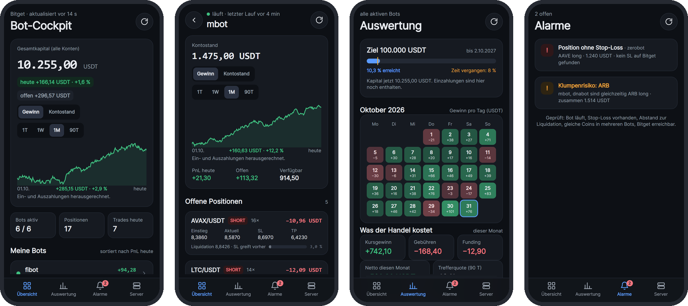
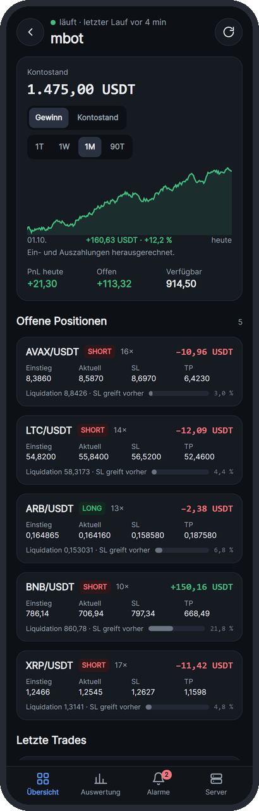
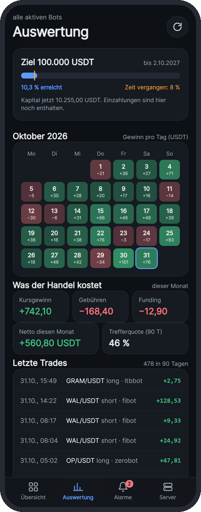
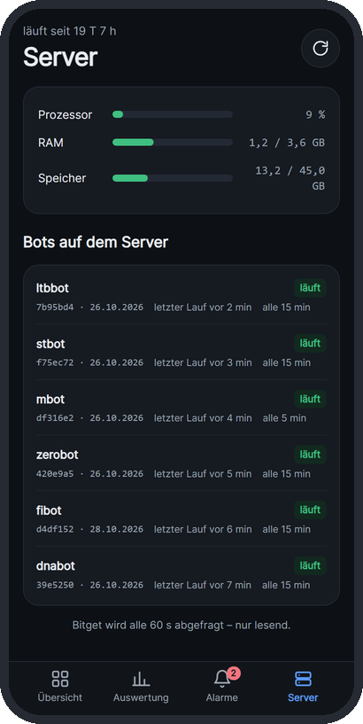
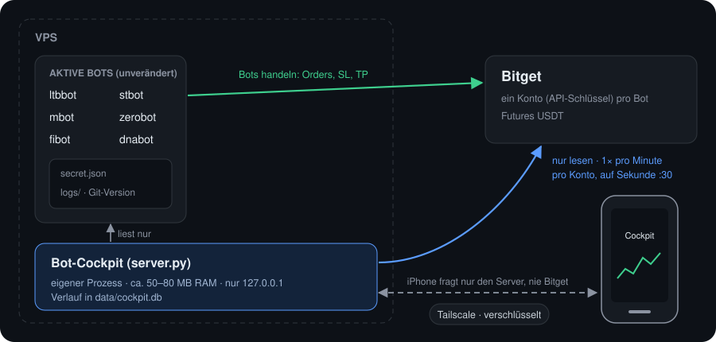
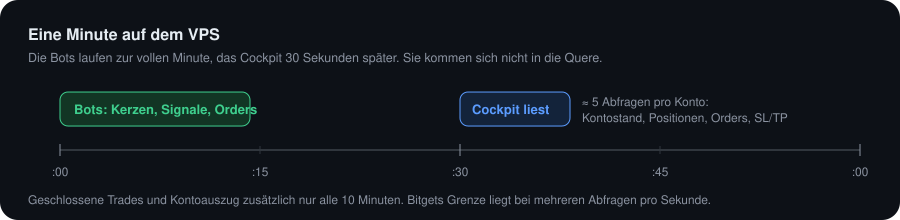

# Bot-Cockpit

Übersicht der aktiven Bitget-Bots fürs iPhone: **ltbbot, stbot, mbot, zerobot, fibot, dnabot**.
Eine Web-App, die auf dem iPhone im Vollbild mit eigenem Symbol läuft, wie eine richtige App.

**Nur lesend.** Das Cockpit sendet keine Orders, storniert nichts und schreibt in keine Bot-Datei.



<sub>Alle Bilder zeigen Beispielzahlen, keine echten Kontostände.</sub>

## Was es zeigt

| Seite | Inhalt |
|---|---|
| Übersicht | Gesamtkapital, PnL heute, offener Gewinn, Bots aktiv, Positionen, Trades heute, Liste der Bots |
| Bot-Detail | Kontostand mit Kurve, offene Positionen mit **Preisleiter** (SL, Einstieg, Kurs, TP, Liquidation auf einer Achse), wartende Orders, letzte Trades, Gewinn und Verlust je Coin, Git-Version |
| Auswertung | Ziel (in der App änderbar), **Monatsrückblick** zum Wischen, **Live gegen Backtest** (Ampel aus dem täglichen Check jedes Bots), Rückgang vom Höchststand, Bot-Rennen (alle starten bei 100), Kalender mit Gewinn pro Tag, Wasserfall Kursgewinn → Gebühren → Funding → Netto, jeder Trade als Punkt (Haltedauer × Ergebnis), Heatmap Wochentag × Uhrzeit, offene Positionen je Coin mit Long/Short, Gewinn je Coin und Bot, letzte Trades. Alle Grafiken antippbar |
| Trade | Jeder Trade in den Listen ist antippbar: Kerzenchart mit Einstieg und Ausstieg, Ergebnis, Gebühren, Funding |
| Alarme | Bot läuft nicht, Position ohne Stop-Loss, Liquidation vor Stop-Loss, gleicher Coin in mehreren Bots (Klumpenrisiko), Bitget-Abfrage fehlgeschlagen. Darunter **Mitteilungen** (an/aus je Art) und die **Zeitleiste** der letzten 7 Tage: eröffnet, geschlossen, Stop verschoben, Ein-/Auszahlung, Alarm |
| Server | Prozessor, RAM, Speicher, Laufzeit, Version und letzter Lauf jedes Bots |

<table>
<tr>
<td align="center" width="33%"><br><b>Bot-Detail</b><br><sub>Positionen mit SL, TP und Abstand zur Liquidation</sub></td>
<td align="center" width="33%"><br><b>Auswertung</b><br><sub>Ziel, Gewinn pro Tag, Kosten, alle Trades</sub></td>
<td align="center" width="33%"><br><b>Server</b><br><sub>Auslastung und Stand jedes Bots</sub></td>
</tr>
</table>

## Stört es die Bots?

Nein.





- Der Server fragt Bitget **einmal pro Minute pro Konto** ab, versetzt auf Sekunde 30, damit es nicht mit den Bot-Läufen zur vollen Minute zusammenfällt. Das sind etwa 5 Anfragen pro Minute und Konto, weit unter Bitgets Grenze von mehreren Anfragen **pro Sekunde**. Geschlossene Trades werden nur alle 10 Minuten geholt.
- Das iPhone fragt nur diesen Server ab, nie Bitget direkt. Wie oft die App offen ist, ändert nichts an der Last bei Bitget.
- Ob ein Bot läuft, erkennt das Cockpit am Zeitpunkt seiner letzten Log-Datei in `logs/`. Diese Dateien werden nur gelesen.
- Der Server ist ein eigener Prozess und braucht etwa 50–80 MB RAM. Stürzt er ab, laufen die Bots weiter.

Die API-Schlüssel kommen aus der `secret.json` des jeweiligen Bots. Nutzen zwei Bots denselben Schlüssel, erkennt das Cockpit das und zählt das Konto nur einmal.

## Installation auf dem VPS

Das Cockpit gehört in **denselben Ordner wie die Bots**, zum Beispiel `/root/cockpit` neben `/root/ltbbot`.
Liegt ein Bot woanders, trägst du in `config.json` beim Bot `"path": "/home/.../bot"` ein.

Das Repo ist **privat**. Der VPS braucht deshalb einmal eine Anmeldung, entweder mit `gh auth login` oder mit einem Token als Passwort beim `git clone`. Das Token bekommst du auf GitHub unter Settings → Developer settings → Fine-grained tokens, mit nur Lesezugriff auf `cockpit`.

```bash
cd ~
git clone https://github.com/Youra82/cockpit.git   # Benutzer: Youra82, Passwort: Token
cd cockpit
bash install.sh          # fragt das App-Passwort ab, prüft die Bot-Ordner, legt den Cron-Eintrag an
tail -f logs/cockpit.log # nach spätestens einer Minute: "Bot-Cockpit läuft auf http://127.0.0.1:8787"
```

Der Server lauscht nur auf `127.0.0.1`, ist also von außen **nicht** erreichbar. Zugang bekommt das iPhone über Tailscale (unten).

## Zugang vom iPhone (Tailscale, kostenlos)

Tailscale baut ein privates, verschlüsseltes Netz zwischen VPS und iPhone. Am VPS wird dafür kein Port geöffnet.

Auf dem VPS:
```bash
curl -fsSL https://tailscale.com/install.sh | sh
sudo tailscale up                 # Link öffnen und mit deinem Konto anmelden
sudo tailscale serve --bg 8787    # zeigt die HTTPS-Adresse, z. B. https://vps-name.tailXXXX.ts.net
```

Auf dem iPhone:
1. App **Tailscale** aus dem App Store laden und mit **demselben Konto** anmelden. Verbindung einschalten.
2. In **Safari** die Adresse `https://vps-name.tailXXXX.ts.net` öffnen und mit dem Passwort anmelden.
3. **Teilen** → **Zum Home-Bildschirm**. Ab dann startet das Cockpit wie eine App.

## Mitteilungen aufs iPhone

Das Cockpit kann sich von selbst melden, auch wenn die App zu ist (iOS 16.4 oder neuer).

1. Cockpit **vom Home-Bildschirm** öffnen (in Safari selbst geht es nicht).
2. Seite **Alarme** → **Mitteilungen einschalten** → erlauben.
3. **Test senden** antippen. Die Mitteilung kommt nach wenigen Sekunden.

Arten, einzeln abschaltbar: Bot läuft nicht, Position ohne Stop-Loss, Liquidation/Liquidationsgefahr, Klumpenrisiko, Bitget-Fehler (aus), große Trades (ab `push_big_trade_usdt`), Tagesabschluss (ab `push_daily_hour` Uhr), Monatsrückblick am 1.
Ein Alarm wird erst gemeldet, wenn er zwei Abfragen hintereinander besteht, damit die kurze Lücke zwischen Einstieg und SL-Order keine Mitteilung auslöst. Jeder Alarm kommt nur einmal, auch nach einem Neustart.
Gesendet wird über Apples Push-Dienst. Die Schlüssel dafür (`data/vapid.pem`) erzeugt der Server beim ersten Start selbst.

## Live gegen Backtest

Die Ampel zeigt das Ergebnis des täglichen Checks, den jeder Bot selbst rechnet (`daily_live_vs_backtest_check.py`). Der Check schreibt dafür zusätzlich `artifacts/db/reports/latest.json`. Das Cockpit liest nur diese Datei und den verlinkten HTML-Bericht und rechnet keinen eigenen Backtest.
Rot: Einstiege fehlen live oder gibt es nur live. Gelb: Ausstieg weicht ab oder es gibt Hinweise, etwa eine Position ohne SL. Grün: alles gleich. Grau: noch kein oder ein veralteter Bericht (älter als 36 h).

## Aktualisieren

```bash
cd ~/cockpit && bash update.sh
```
`config.json` (Passwort, Bot-Liste) und `data/` (Kapitalverlauf, Trades) bleiben dabei erhalten.

## Einstellungen (`config.json`)

| Schlüssel | Bedeutung |
|---|---|
| `password` | App-Passwort (Pflicht) |
| `bots` | aktive Bots mit `cycle_minutes`. Wird ein Bot länger als 3 Zyklen (mindestens 20 min) nicht ausgeführt, gilt er als „läuft nicht“ |
| `bots_dir` | Ordner, in dem die Bots liegen (Standard: eine Ebene über dem Cockpit) |
| `goal_usdt`, `goal_start_date`, `goal_date` | Startwerte für den Ziel-Balken auf der Seite Auswertung. In der App über **Ändern** anpassbar, das wird in `data/goal.json` gespeichert und hat Vorrang |
| `poll_seconds`, `poll_offset_seconds` | Abfragetakt (Standard: 60 s, auf Sekunde 30) |
| `push_big_trade_usdt` | ab diesem Betrag (Gewinn oder Verlust) gibt es eine Mitteilung „großer Trade“ (Standard 5) |
| `push_daily_hour` | Uhrzeit des Tagesabschlusses (Standard 21) |

## Grenzen der ersten Version

- Die Kapitalkurve reicht beim ersten Start **90 Tage zurück**. Sie wird aus Bitgets Kontoauszug gebaut (`/api/v2/mix/account/bill`), etwa 10 Abfragen pro Konto, einmalig. Danach kommen nur die neuen Einträge dazu, und alle 5 Minuten wird ein eigener Kontostand gespeichert.
- **Gewinn** rechnet Ein- und Auszahlungen heraus (Kontoauszug-Typ `trans…`). **Kontostand** zeigt den echten Verlauf mit Einzahlungs-Sprüngen.
- Die Kurve zeigt den **realisierten** Kontostand, also ohne offene Positionen. Kontoauszug und eigene Messungen zählen damit dasselbe, es gibt keinen Sprung am Übergang. Den offenen Gewinn zeigt die Übersicht separat: **Realisiert heute + Offen jetzt = Zusammen**.
- **Heute** beginnt um 0 Uhr, passend zu „Realisiert heute“. Ein Finger auf der Kurve zeigt Wert und Zeitpunkt an dieser Stelle.
- Liquidationen aus dem Kontoauszug (`burst_…`) der letzten 7 Tage erscheinen als Alarm.
- Die Trade-Historie wird beim ersten Start mit den letzten 100 geschlossenen Positionen pro Konto gefüllt und wächst danach weiter.
- Widgets für den Home-Bildschirm gibt es für Web-Apps unter iOS nicht.
- Der Trade-Chart zeigt Einstieg und Ausstieg. SL und TP eines geschlossenen Trades speichert Bitget in der Trade-Historie nicht, deshalb fehlen sie dort.
